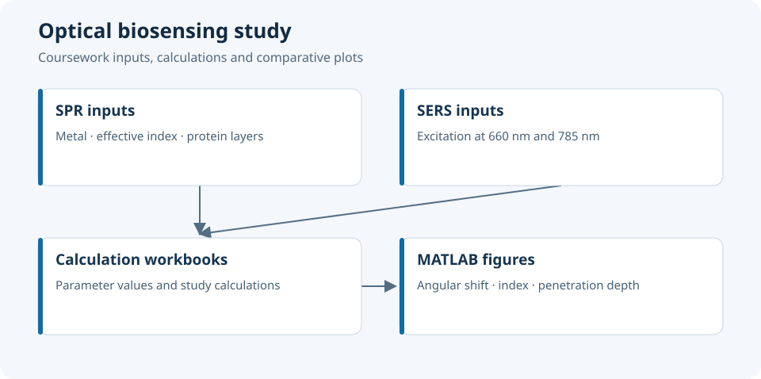

# Optical Biosensing — SPR and SERS Laboratory Study

SPR and SERS biosensing studies with MATLAB plots and calculation workbooks.



*Coursework inputs, calculations and comparative plots.*

## Scientific scope

SPR links the optical resonance condition to the metal/dielectric interface and the effective refractive index near the surface. Changes associated with protein layers are explored through angular shifts and comparative plots for gold, silver and aluminium.

SERS exercises examine excitation at 660 nm and 785 nm. The spreadsheets and report contain the underlying coursework calculations; this repository does not include a complete acquisition system or embedded sensor firmware.

## Repository map

| Artifact | Purpose |
|---|---|
| [Laboratory report](compte_rendu_tp1_biocapteurs.odt) | Experimental context and working analysis |
| [Surface-plasmon calculations](tableau_1_plasmon_de_surface_calculs.xlsx) | Calculation workbook |
| [SERS, 660 nm](tableau_2_sers_excitation_660nm.xlsx) | Excitation-specific workbook |
| [SERS, 785 nm](tableau_3_sers_excitation_785nm.xlsx) | Excitation-specific workbook |
| [MATLAB scripts](src/) | Comparative plots and simplified physical calculations |

## MATLAB implementation

- [`delta_theta.m`](src/delta_theta.m): compares preset angular shifts for one protein layer and two layers.
- [`lambda_plot.m`](src/lambda_plot.m): wavelength-related visualisation.
- [`wavelength_by_medium.m`](src/wavelength_by_medium.m): the same wavelength data grouped by surrounding medium, rather than by metal.
- [`zd_plot.m`](src/zd_plot.m): compares preset penetration-depth values.
- The independent [RF skin-depth study](studies/rf_skin_depth/) computes conductive skin depth at 1 GHz; it is kept outside the optical plotting scripts.

The former `neff_plot_correct.m` filename was misleading: its arrays contain wavelengths in nm, not effective refractive indices. It is now named `wavelength_by_medium.m`; its numerical data are preserved. The RF example is separated because conductive skin depth at 1 GHz and optical SPR field penetration use different physical models.

## Reproducing the figures

```bash
git clone https://github.com/tedjelmoulksn-dotcom/Bio_capteur.git
cd Bio_capteur
```

Open MATLAB, change to `src/` and run the selected optical script. For the RF example, run `studies/rf_skin_depth/skin_depth_1ghz.m` separately. Open the report in an ODT-compatible editor and inspect spreadsheet formulas alongside their units and assumptions.

## Interpretation and validation

Read the plots together with the workbook inputs: metal, wavelength, refractive index and protein-layer configuration determine the comparison. A preset angular shift is a plotted input; a calculated skin depth comes from a model. Keeping these roles explicit makes the scientific interpretation traceable.

The scripts distinguish two operations: plotting workbook/report values and computing a response from physical parameters. Track the source and units of each plotted input so that angular-shift, penetration-depth and skin-depth comparisons retain their intended meaning.

## Skills represented

Optical instrumentation, interfacial sensing, metal-dependent response, mathematical modelling and communication of scientific results.

## Licence

No project-wide licence has been defined.

